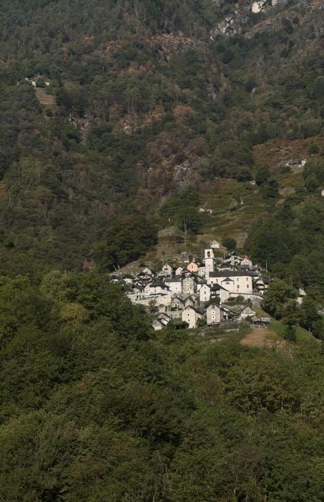
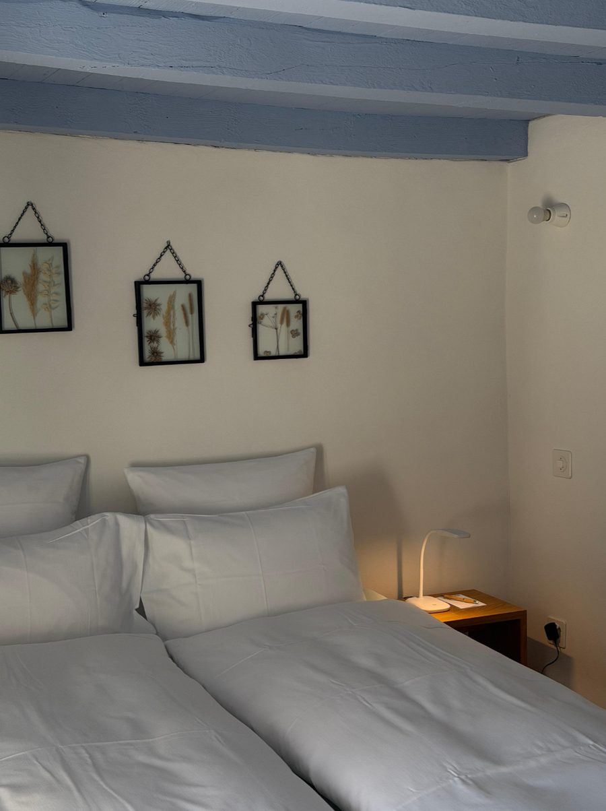
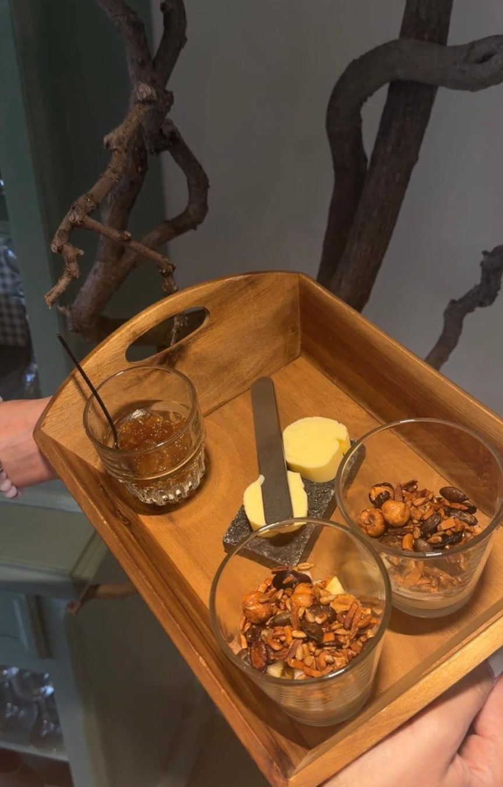

<!-- PLATZHALTER: Diesen Text durch den finalen Beitrag ersetzen. -->

Mitten im Verzascatal liegt Corippo, lange die kleinste Gemeinde der Schweiz. Um das Dorf zu beleben, wurde es zum Hotel: Die Zimmer sind in den alten Rustici verteilt.

## Die Zimmer: einfach, aber mit Charme

Luxus darf man nicht erwarten. Dafür schläft man mitten in einem historischen Dorf, umgeben von Natur und Ruhe.

## Frühstück: liebevoll und bedacht

Jeder bekommt ein eigenes Tablett mit hausgemachtem Granola. Wir haben gleich ein paar Gläser mit nach Hause genommen.

## Unser Fazit

Ruhe, Natur, frische Küche und ein Hotel mit ganz eigenem Charakter: besonders und verzaubernd.
