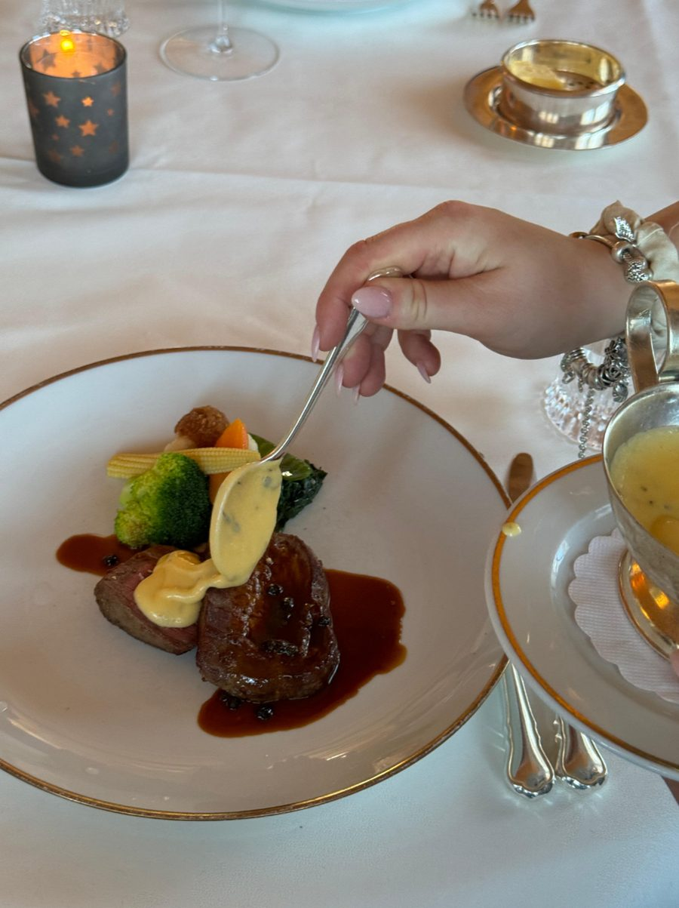
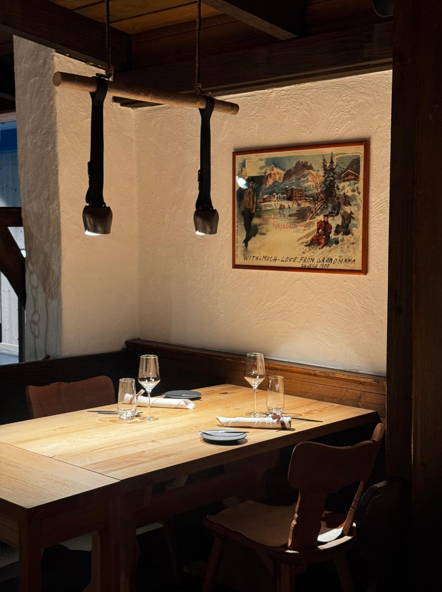
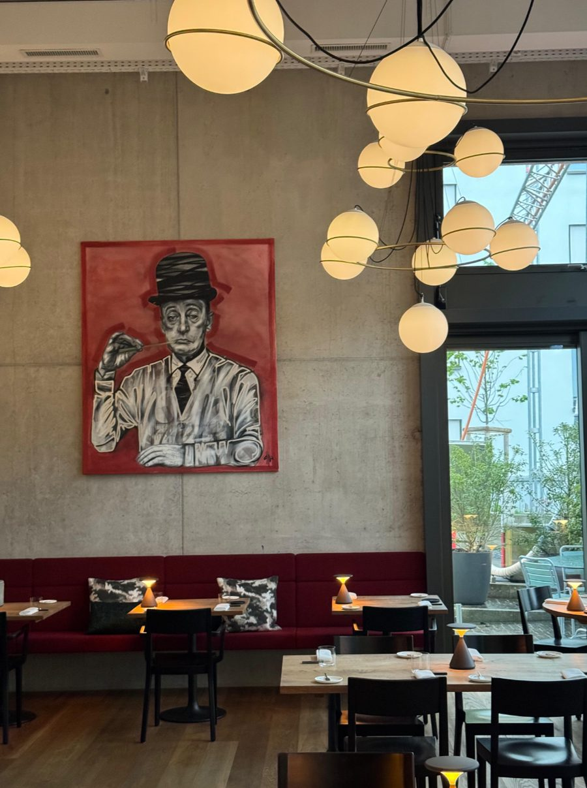
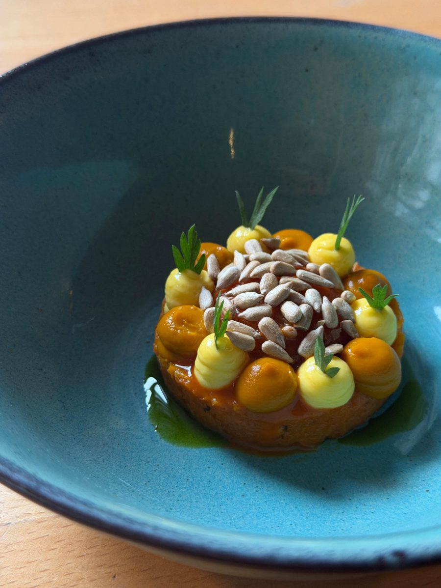
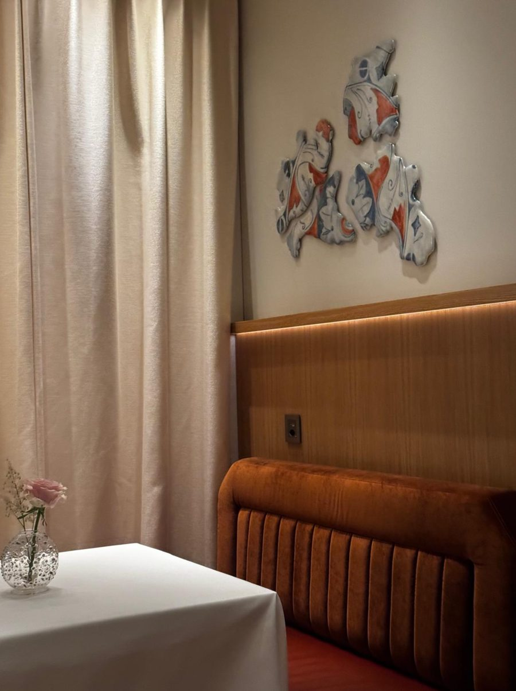

<!-- PLATZHALTER: Diesen Text durch den finalen Beitrag ersetzen. -->

Fünf Gourmet-Restaurants, in denen wir richtig gut gegessen haben, im Appenzellerland, in Grindelwald und in Zürich. Das ist keine Rangliste, sondern eine Auswahl von Adressen, die wir aus Überzeugung empfehlen.

## 1. Gasthaus zum Gupf, Rehetobel

Hoch über dem Bodensee steht ein stattliches Holzhaus mit herzlichen Gastgebern, präziser Küche und einem riesigen Weinkeller.

## 2. 1910 Gourmet by Hausers, Grindelwald

Sechs Tische, ein Stübli mit dem originalen Herd von 1910 und eine wahnsinnig kreative Küche.

## 3. Restaurant Anna, Zürich

Eines unserer Lieblingsrestaurants in Zürich: frisch, kreativ und angenehm unkompliziert.

## 4. AMEO, Zürich Wiedikon

Kunst trifft Fine Dining: Alle zwei bis drei Monate wechselt der Künstler und mit ihm das Menü.

## 5. ORSINI, Zürich Paradeplatz

Italienisches Fine Dining im Mandarin Oriental Savoy, bis ins kleinste Detail durchdacht.

*Stand der Angaben: Oktober 2026, ohne Gewähr. Öffnungszeiten bitte direkt beim Restaurant prüfen.*
