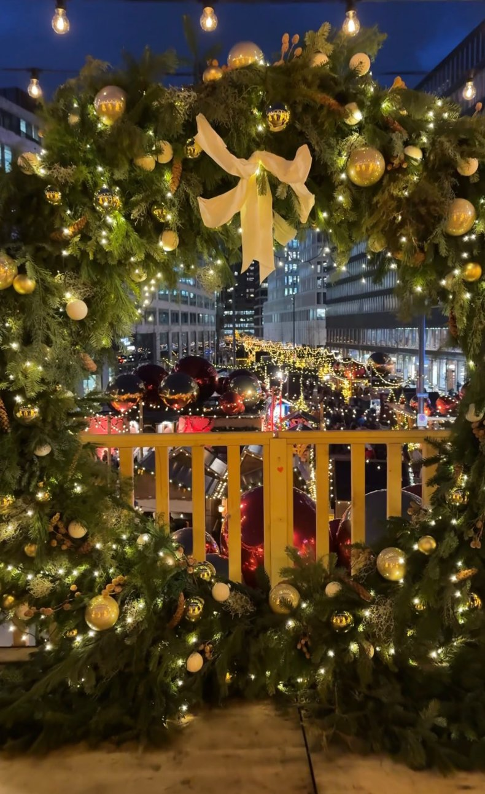

<!-- PLATZHALTER: Diesen Text durch den finalen Beitrag ersetzen. -->

Ab dem 19. November verwandelt sich Zürich in eine Stadt voller Weihnachtsmärkte. Hier sind alle wichtigen Märkte auf einen Blick, mit dem neuen Bellevue Noël, der 2026 zum ersten Mal stattfindet.

| Markt | Datum |
| --- | --- |
| Bellevue Noël, Sechseläutenplatz | 19. Nov – 23. Dez |
| Hauptbahnhof | 19. Nov – 24. Dez |
| Dörfli, Niederdorf | 19. Nov – 23. Dez |
| Weihnachtsallee, Europaallee | 19. Nov – 23. Dez |
| Münsterhof | 19. Nov – 24. Dez |
| Singing Christmas Tree, Werdmühleplatz | 19. Nov – 23. Dez |

## Unser Tipp

Für ein Fondue im Chalet früh reservieren und den Spaziergang mit den Lucy-Lichtern an der Bahnhofstrasse verbinden.

*Stand der Angaben: Oktober 2026, ohne Gewähr.*
