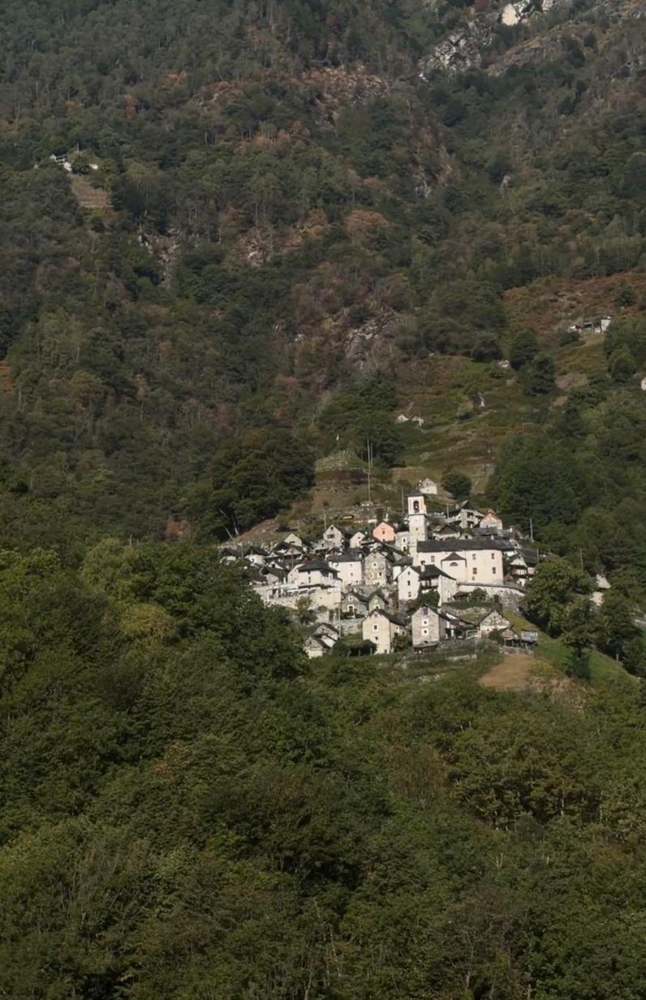
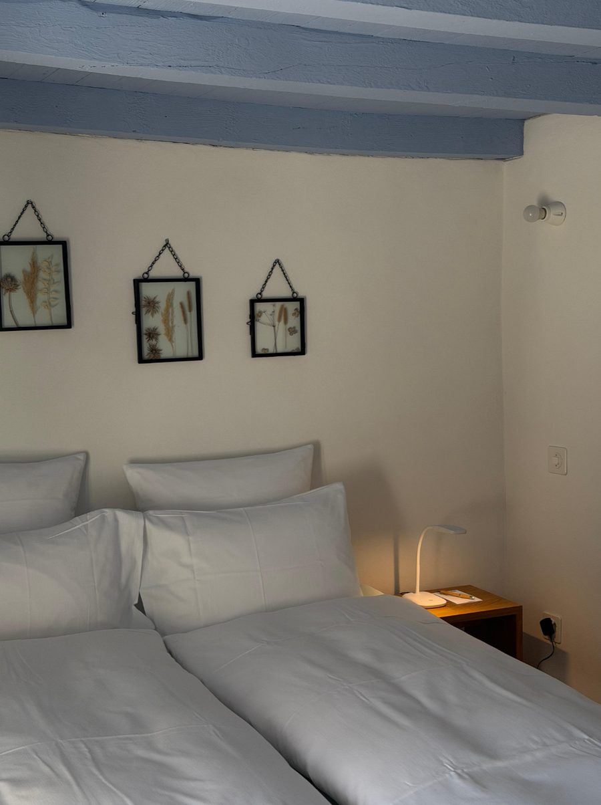
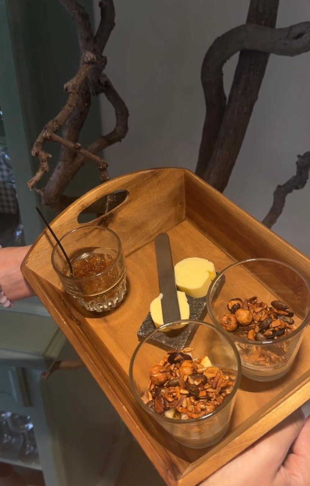

<!-- PLACEHOLDER: replace with the final story. -->

Corippo sits in the heart of the Verzasca Valley and was long Switzerland's smallest municipality. To bring the village back to life, it became a hotel, with rooms spread across its old stone rustici.

## The rooms: simple, full of charm

Don't expect luxury. Instead you sleep in the middle of a historic village, surrounded by nature and silence.

## Breakfast: thoughtful and lovely

Every guest gets their own tray with homemade granola. We took a few jars home with us.

## Our verdict

Calm, nature, fresh cooking and a hotel with real character: special and enchanting.
