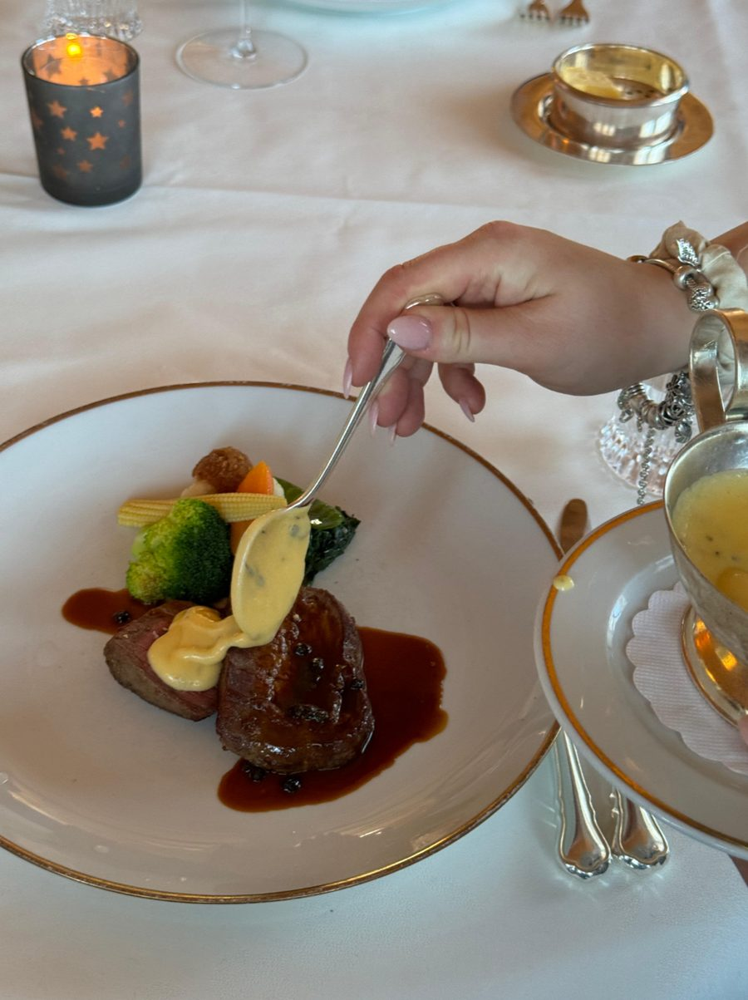
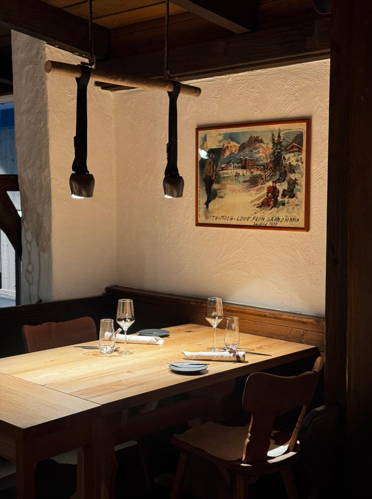
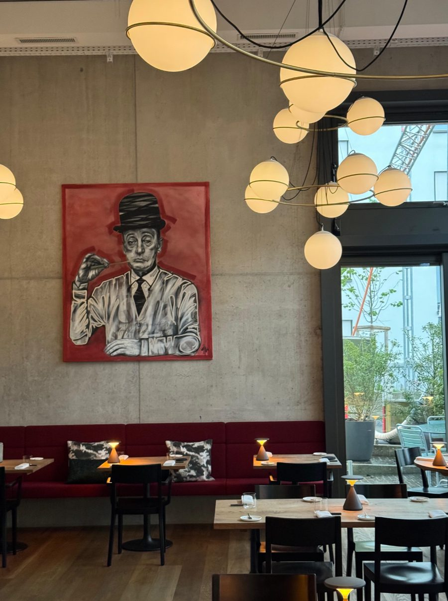
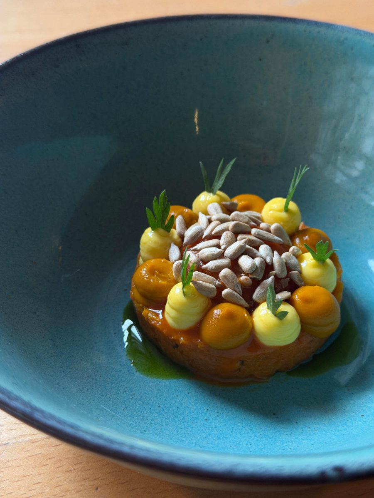
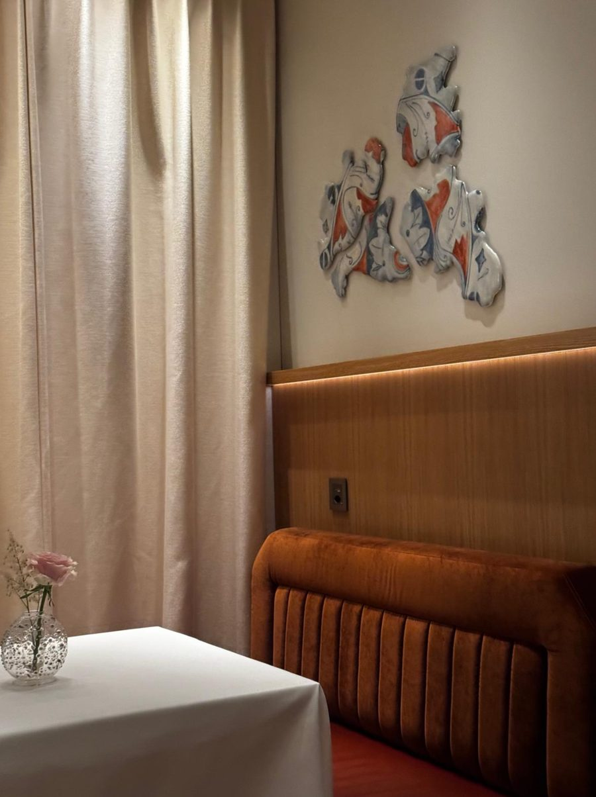

<!-- PLACEHOLDER: replace with the final story. -->

Five fine dining restaurants where we have eaten exceptionally well, in Appenzell, Grindelwald and Zurich. Not a ranking, but a selection we recommend with conviction.

## 1. Gasthaus zum Gupf, Rehetobel

A grand wooden inn high above Lake Constance, with warm hosts, precise cooking and an enormous wine cellar.

## 2. 1910 Gourmet by Hausers, Grindelwald

Six tables, a cosy parlour with its original 1910 stove and a wildly creative kitchen.

## 3. Restaurant Anna, Zurich

One of our favourite restaurants in Zurich: fresh, creative and refreshingly unpretentious.

## 4. AMEO, Zurich Wiedikon

Fine dining meets art: every two to three months a new artist arrives, and the menu changes with them.

## 5. ORSINI, Zurich Paradeplatz

Italian fine dining at the Mandarin Oriental Savoy, considered down to the last detail.

*Information as of October 2026, without guarantee. Please check opening hours directly with each restaurant.*
