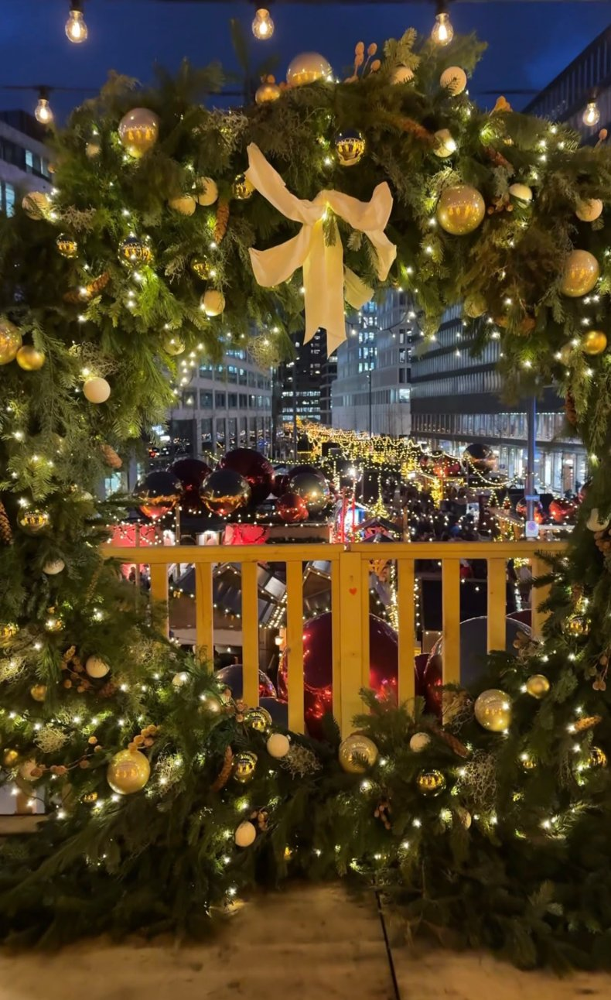

<!-- PLACEHOLDER: replace with the final story. -->

From 19 November, Zurich turns into a city of Christmas markets. Here are all the key markets at a glance, including the new Bellevue Noël, held for the first time in 2026.

| Market | Dates |
| --- | --- |
| Bellevue Noël, Sechseläutenplatz | 19 Nov – 23 Dec |
| Main station | 19 Nov – 24 Dec |
| Dörfli, Old Town | 19 Nov – 23 Dec |
| Weihnachtsallee, Europaallee | 19 Nov – 23 Dec |
| Münsterhof | 19 Nov – 24 Dec |
| Singing Christmas Tree, Werdmühleplatz | 19 Nov – 23 Dec |

## Our tip

Book a fondue chalet early, and combine your visit with a stroll under the Lucy lights on Bahnhofstrasse.

*Information as of October 2026, without guarantee.*
